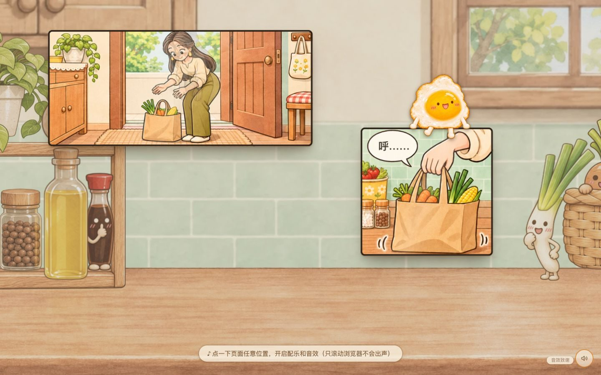
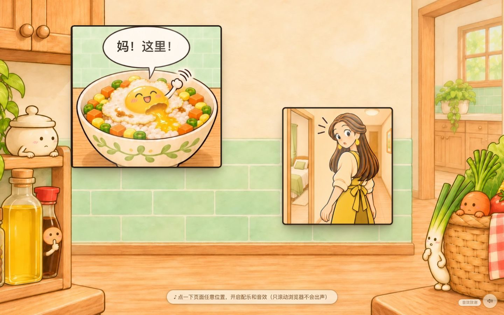
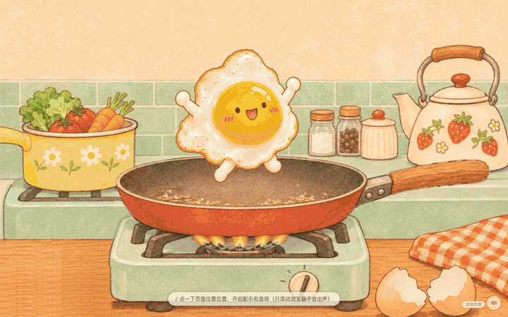

# Egg Breakfast Comic (荷包蛋的早餐)

A comic you scroll through, with sound. A fried egg bounces in a pan. A mom comes home, cooks fried rice, and catches the egg on her spatula. The story is told in Chinese, in about 55 screens of scrolling.

**Try it:** [egg-breakfast-comic.vercel.app/preview/visual](https://egg-breakfast-comic.vercel.app/preview/visual) (best on a laptop, with sound on; click once on the page to turn the sound on)


## What it is

Most web comics are pictures in a row. This one tries to feel like being in the room. The kitchen is always alive in the background. The comic panels float over it, and the egg can move between the two.

It is for anyone who likes small, warm stories. It is also my experiment in how far a comic can go on the web.

## What you will see



Scroll down and the story plays:

1. A fried egg bounces in a pan. Nobody is cooking yet.
2. The mom comes home with groceries and decides what to cook.
3. She chops, stir-fries and mixes a sauce, one panel at a time.
4. She feels something is missing. Then she hears a small "pop" from the pan.
5. The egg jumps out of the pan, over the panel edges, and lands on her spatula.
6. She puts it on the rice, pours the sauce, and cuts into the yolk.
7. Then comes a short twist at the end. I will not spoil it here.




A quick scroll-through (the real page moves smoothly; this GIF only shows a few steps):



## The ideas I wanted to try

- **Experience first.** The point is how it feels to scroll, not only what the pictures say.
- **Sound.** Frying, chopping, stirring and room sounds fade in and out as you scroll. The mom has short spoken sounds like "hm?" and "oh!". There is quiet jazz in the background. Sound stays off until you click the page.
- **Background and foreground.** The kitchen stays behind the panels. Near things move more than far things when you scroll, like looking through a window.
- **Breaking the frame.** Most of the time, the egg stays in the kitchen and the mom stays in her panels. Only once does the egg cross the border and land in her spatula.
- **Small motion inside panels.** Panels blink, steam rises, and nearby panels shake a little when the egg lands. They are tiny on purpose.
- **Still pictures that move.** Every picture is a still drawing. I cut the egg and the kitchen into separate layers, so they can move by themselves.

## What inspired it

These are the projects and ideas that shaped the design (from my design notes in [`docs/`](docs/)):

- **The Boat**: a scroll-driven web story. It gave me the idea to tie the sound volume to scrolling, and to fire a small effect once when something comes into view.
- **Ponpon Mania** (a Codrops tutorial from October 2025): split each panel into layers, and animate only two or three things in it, each for a reason.
- **Codrops "Seam Transitions"**: the idea of a rough, hand-torn edge between scenes. I only borrowed the idea. I did not copy its code.

## How it was made

- **Story and pictures:** The story and storyboard are mine. The illustrations were made with AI image tools (ChatGPT) from my storyboard and prompts. The egg, the mom and the kitchen were then cut into layers with small Python scripts in [`tools/`](tools/) and by hand.
- **Code:** [Next.js](https://nextjs.org) (React, TypeScript), [GSAP](https://gsap.com) for the small animations, [Lenis](https://lenis.darkroom.engineering) for smooth scrolling, Tailwind CSS. I built it with Claude Code.
- **One clock for everything:** All timing lives in one file, [`src/lib/beats.json`](src/lib/beats.json). Pictures, camera and sound all read from it. The readable version is [`docs/BEATS.md`](docs/BEATS.md).
- **Sound:** Sound effects are free recordings from Freesound, Pixabay and Mixkit. The music is "Jazz Brunch" by Kevin MacLeod ([CC BY 3.0](https://creativecommons.org/licenses/by/3.0/)). The mom's voice sounds were made with ElevenLabs. Sources and licenses are listed in [`public/assets/audio/LICENSES.md`](public/assets/audio/LICENSES.md), and also under "音效致谢" (sound credits) on the page.

## Run it on your computer

You need [Node.js](https://nodejs.org) (version 20 or newer).

```bash
npm install
npm run dev
```

Then open <http://localhost:3000/preview/visual>.

Other commands: `npm run build` makes a production build, and `npm run lint` checks the code. There is no test suite yet.

## What is real and what is unfinished

- The full story is real and works from start to finish. It is live at the link above.
- The page address `/preview/visual` is a leftover from when I built it as a preview. The home page `/` is an older, shorter version that ends with a "placeholder" screen. I plan to make the new version the home page.
- It is built for a laptop or desktop. I have not tested it carefully on phones.
- The text in the comic is Chinese only. There are no English captions yet.
- Everything is hand-tuned for scrolling with a trackpad or mouse. It is not made for screen readers.
- The art and voices come from AI tools. Please check the licenses in the sound credits before reusing anything.

## Folders

| Folder | What is in it |
|---|---|
| `src/app/preview/visual/` | The finished story page |
| `src/components/kitchen/` | The kitchen, the egg and the sound |
| `src/lib/beats.json` | The timing for the whole story |
| `public/assets/` | Pictures and sounds |
| `tools/` | Scripts that cut the art into layers and prepare the audio |
| `docs/` | Design notes (mostly in Chinese) |

## Credits

Made by Rachel Miao. Music: "Jazz Brunch" by Kevin MacLeod (incompetech.com), licensed under CC BY 3.0.
